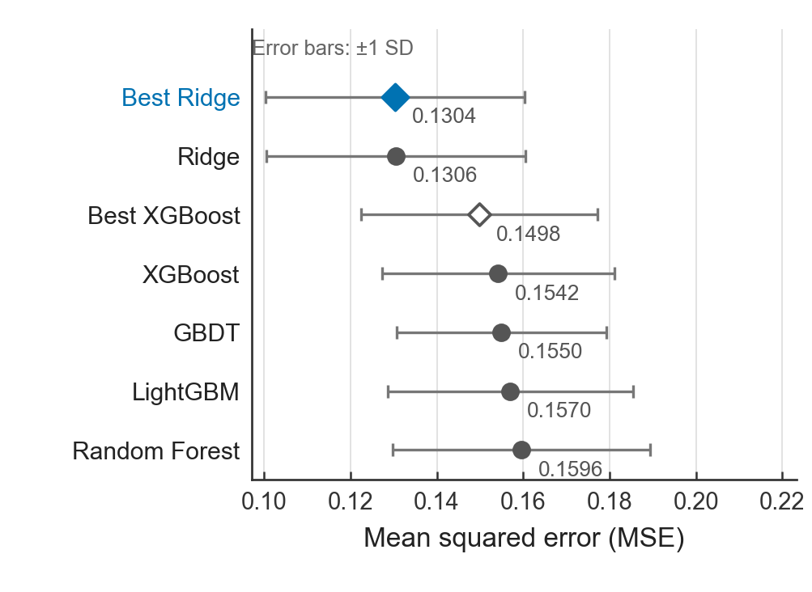

# Industrial Steam Prediction

**工业蒸汽量预测：正则化回归、树模型比较与可追溯实验工程。**

A reproducibility-focused regression study with fixed validation protocols, model comparisons, model-specific SHAP analysis, and bilingual research manuscripts.

[中文论文](paper/zju_zh_layout_revision/main.pdf) · [English manuscript](paper/acm_mm_layout_revision/main.pdf) · [快速开始](#快速开始) · [复现指南](docs/REPRODUCIBILITY.md) · [文档导航](docs/README.md)

## 项目概览

使用38个匿名特征预测工业蒸汽量，比较线性模型、树模型、特征处理和融合方案，并将Notebook实验整理为配置驱动、输出隔离、可测试的Python工程。

本项目关注三个问题：

- **基线是否足够强？** Ridge在当前数据与验证设置下优于所比较的树模型。
- **额外处理是否有收益？** KBest20、PCA95未改善Ridge；Ridge调参收益较小。
- **融合与解释能说明什么？** 融合仅有边际数值改善；SHAP只解释Best XGBoost分支。

| 项目 | 设置 |
|---|---|
| 有标签数据 | 2,888行，38个特征V0–V37，标签target |
| 无标签测试数据 | 1,925行；不报告真实性能指标 |
| 主验证协议 | 5折TimeSeriesSplit；KFold仅作敏感性分析 |
| 模型 | Ridge、Random Forest、GBDT、XGBoost、LightGBM及融合模型 |
| 工程 | 配置驱动CLI、折内Pipeline、安全输出、合成测试、结果来源核验 |

## 主要结果

### 五折模型比较

以下为已归档的五折TimeSeriesSplit结果，RMSE为逐折RMSE的平均值。

| 模型 | MSE ↓ | RMSE ↓ | MAE ↓ | R² ↑ |
|---|---:|---:|---:|---:|
| Best Ridge（α=5） | **0.1304** | 0.3593 | 0.2639 | 0.8525 |
| Ridge（α=1） | 0.1306 | 0.3595 | 0.2643 | 0.8523 |
| Best XGBoost | 0.1498 | 0.3858 | 0.2888 | 0.8261 |
| XGBoost | 0.1542 | 0.3915 | 0.2952 | 0.8203 |
| GBDT | 0.1550 | 0.3927 | 0.2964 | 0.8207 |
| LightGBM | 0.1570 | 0.3950 | 0.2990 | 0.8186 |
| Random Forest | 0.1596 | 0.3981 | 0.2997 | 0.8164 |

来源：[完整精度CSV](results/final_model_comparison.csv)。Best Ridge与普通Ridge数值接近，不将差距解释为显著提升。



*误差棒为五折之间的±1 SD，不是置信区间。*

### 融合验证：不同协议，单独比较

| 模型 | 481样本融合验证MSE ↓ |
|---|---:|
| Weighted Blend（0.7 Ridge + 0.3 XGBoost） | **0.176594** |
| Best Ridge | 0.176921 |
| Stacking | 0.178956 |
| Best XGBoost | 0.196809 |

来源：[融合比较CSV](results/fusion_model_comparison.csv)。Weighted Blend相对Best Ridge仅改善约**0.19%**，属于边际数值收益。

该子集未用于融合权重选择或Stacking元模型拟合，但上游调参可能使用过其标签，因此不是严格独立外部测试集。不能将上表与五折结果混为同一排行榜。

## 快速开始

```bash
git clone https://github.com/wzhikun-helper/industrial-steam-prediction.git
cd industrial-steam-prediction
```

环境声明见[environment.yml](environment.yml)。在独立环境中准备依赖后，可**不使用原始数据、不训练模型**地运行：

```bash
python -B scripts/run_experiment.py --help
python -B scripts/run_experiment.py --config configs/experiment.yaml --output-dir staging/readme_check_001 --stage ridge-baseline --check-only
python -B -m unittest discover -s tests -v
python -B scripts/verify_frozen_results.py --hashes-only
```

check-only不拟合、不创建输出目录，也不检查真实数据Schema。目标目录必须不存在。数据准备、八阶段能力和复现差异见[复现指南](docs/REPRODUCIBILITY.md)。原始数据不随仓库分发。

## 论文与研究材料

| 内容 | 入口 |
|---|---|
| 中文研究稿 | [PDF](paper/zju_zh_layout_revision/main.pdf) · [源码](paper/zju_zh_layout_revision/main.tex) · [构建说明](paper/zju_zh_layout_revision/BUILD.md) |
| English research manuscript | [PDF](paper/acm_mm_layout_revision/main.pdf) · [Source](paper/acm_mm_layout_revision/main.tex) · [Build](paper/acm_mm_layout_revision/BUILD.md) |
| 实验与图表来源 | [结果来源清单](results/paper_result_manifest.md) · [89项冻结哈希](results/frozen_artifacts_sha256.md) |
| Python工程 | [工程验收](docs/PYTHON_ENGINEERING_ACCEPTANCE.md) · [实现说明](scripts/README.md) |
| ML审计Skill | [SKILL.md](.agents/skills/ml-experiment-audit/SKILL.md) · [两页示范](docs/ml_workflow_demo.pdf) · [执行验证与限制](docs/END_TO_END_SKILL_WORKFLOW_ACCEPTANCE.md) |
| 学习与课程材料 | [文档导航](docs/README.md)，含LaTeX学习、发表论文对照及历史验收 |

两份论文为研究学习稿，不代表已被期刊或会议接收。paper/*_layout_revision/为优先阅读版本；原稿保留冻结及修改对照意义。不要在原稿目录编译或覆盖正式图片。

## 目录结构

```text
configs/       固定协议与实验配置
src/           数据、模型、评价、验证、融合与安全运行模块
scripts/       实验CLI、结果导出及核验入口
tests/         合成数据离线测试
results/       冻结指标、论文CSV及来源清单
figures/paper/ 正式中英文论文图
paper/         中英文论文源码、PDF及历史版本
docs/          复现指南、工程文档与研究学习材料
notebooks/     历史探索实验；不作为默认执行入口
.agents/skills/ml-experiment-audit/ 只读优先的ML审计Skill
```

## 复现状态与局限

- Ridge、特征处理、Ridge调参和LightGBM基线在已验证环境中达到严格数值一致；RF、GBDT及XGBoost存在数值差异，跨版本原因尚未全部确认。
- 新工程的真实融合、SHAP和最终预测入口仍禁用；协议测试通过不等于完整训练复现。
- 特征匿名、时间语义未完全确认，且调参与评价不是嵌套设计；结论限于当前数据和设置，不作显著性或因果推断。
- SHAP解释Best XGBoost，而非Weighted Blend；无标签测试集不能计算真实性能指标。

详细边界见[复现指南](docs/REPRODUCIBILITY.md)。本仓库尚未指定开源许可证；代码、数据和第三方资料的使用权限应分别确认，不默认继承参考项目的许可。
